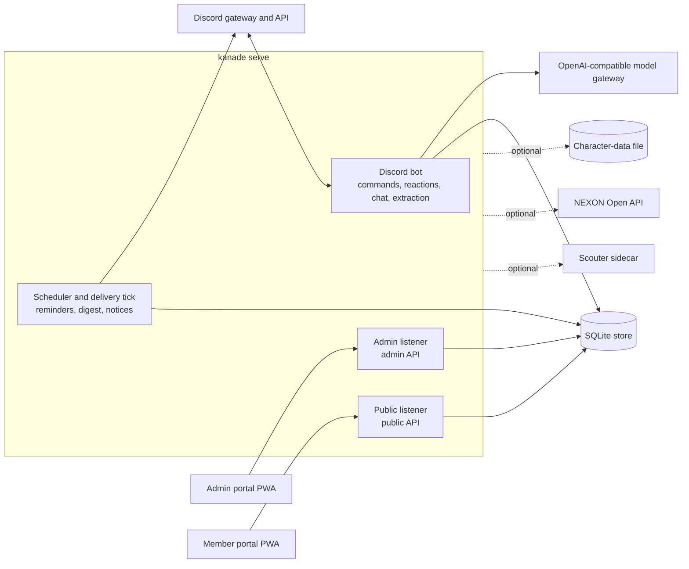

<div align="center">

# Kanade

**A Discord bot that runs a MapleStory group's weekly boss schedule.**

*One Rust binary for one Discord server: the bot, the reminders, an admin portal and a member portal, deployed with Docker Compose.*

[](CHANGELOG.md)
[](rust-toolchain.toml)
[](LICENSE)
[](https://github.com/hoshinoht/kanade-bot/actions/workflows/ci.yml)

[At a glance](#at-a-glance) · [Features](#features) · [Architecture](#architecture) · [Quick start](#quick-start) · [Security](#security) · [Development](#development) · [Coming from v4](#coming-from-v4) · [License](#license)

</div>

> **The schedule belongs to the group: Kanade keeps it, posts it and reminds people, and nothing a model reads reaches it until a person approves.**
> Character data and estimates are shown to help plan a party, never used to judge or block one.

> [!NOTE]
> Beta: `1.0.0-beta.14`, running live for one guild. Settings, the HTTP API and the store may still change between betas; read [CHANGELOG.md](CHANGELOG.md) before upgrading.

## At a glance

| | |
|---|---|
| **Binary** | `kanade`, Rust edition 2024, toolchain pinned to 1.99.1 |
| **Commands** | `serve [--offline]`, `healthcheck`, `models check`, `backup`, `restore`, `portal`, `sessions`, `token rotate`, `ctl emojis`, `--version` |
| **Discord** | One gateway session for one configured guild; slash commands registered per guild, never globally |
| **Storage** | SQLite with an owner lock (one process per store); the optional character data has its own file |
| **Models** | Any OpenAI-compatible model gateway, with separate chat, extraction and rewrite roles |
| **Web** | Two Svelte 5 PWAs served by the binary: the admin portal and the public member portal |
| **Config** | `kanade.toml` for settings, `KANADE_*` variables override it, secrets only in files |
| **Deploy** | Docker Compose; distroless non-root image in a read-only container |

## Features

### Scheduling

- **Weekly timings:** `/fixed` or the admin Fixed page records a party's weekly boss timing; the first participant owns it unless an admin pins an owner.
- **Runs per boss week:** timings become concrete runs for the current and next boss week at the configured reset, and runs can be moved, swapped, cancelled or marked done.
- **RSVPs:** members answer with reactions on the reminder and digest cards, `/rsvp`, or the member portal.

### Discord delivery

- **Reminder cards:** a day-of card at the configured ping time and countdown pings at configured minutes before each run.
- **Weekly digest:** one digest per boss week in the post channel, edited in place as the schedule changes.
- **Slash commands:** `/schedule`, `/fixed`, `/amend`, `/status`, `/swap`, `/rsvp`, `/pings`, `/style`, `/limits`, `/rescan`, admin-only `/say`, `/nick` and `/debug`, and `/character` with the character data module.

### Chat and extraction

- **Chatbot:** answers mentions and replies in the configured chat categories, for holders of the chat role, in the voice of a [persona](config/personas/README.md); schedule changes come back as proposal cards.
- **Extraction:** reads the watched channels and turns schedule talk into proposal cards that a member approves or rejects; off until switched on in Config.
- **Model gateway:** any OpenAI-compatible server, with per-role models, reasoning levels and capacity groups. The provider receives raw member names, IDs, message text and URLs; nothing is masked.

### Admin portal

- **Week board and run sheet:** a seven-day planner with drag and keyboard moves, and a full sheet per run for its party, answers, status and history.
- **Inbox and drafts:** approve or edit extracted proposals and member requests; stage changes in a draft, settle conflicts and merge them as one change.
- **History, Config and Limits:** a revertible change history with backup checkpoints, live settings, and the model permits, queue and chat allowances.

### Public member portal

- **Opt-in:** served only on its own listener with its own Discord application, and open only while the admin Config switch is on.
- **Members' own view:** the boss week, their runs and answers, moves, requests and weekly timings, the boss guides, and their characters when the roster module is on.

### Optional modules

- **Roster:** each member's MapleSEA characters and which one they bring to a run (`modules.roster`).
- **Character data:** NEXON Open API data for linked characters, after the member consents, in a separate SQLite file kept out of backups, logs and model prompts (`modules.character_data`).
- **Scouter estimates:** clear-time estimates from a separate scouter sidecar that is not part of this repository; it is sent roster IGNs only (`character_data.scouter_url`). Two Config switches, off by default, let reminder headers be worded from the party's estimate and lightly tease members who opted in; the rewrite model then gets estimate shares and an admin's running-joke note, never a name or IGN.

Full behaviour, settings and limits are in [docs/v5/runtime-bootstrap.md](docs/v5/runtime-bootstrap.md).

## Architecture



`kanade serve` is one process that owns the store; the admin and public routers are built separately, and the public one has no admin route. The dotted parts run only with the character data module. Details: [docs/v5/runtime-bootstrap.md](docs/v5/runtime-bootstrap.md).

## Quick start

**Requirements:** Docker with Compose, a Discord application with a bot token (Server Members and Message Content intents on, invited with the `bot` and `applications.commands` scopes), an OpenAI-compatible model gateway and its key. The [runbook's Quick start](deploy/README.md#quick-start) walks through the Discord setup and each step below.

```sh
# 1. Settings: copy the template and fill in its uncommented keys
#    (runtime.timezone, discord.guild_id, discord.bossing_role_id, models.base_url).
cp kanade.example.toml kanade.toml && $EDITOR kanade.toml

# 2. Secrets: one line per file; on Linux, readable by uid 65532.
SECRETS="$HOME/.config/kanade/v5/secrets" && mkdir -p "$SECRETS"
#    discord_token, admin_token (openssl rand -base64 48), model_api_key

# 3. Backups directory: Compose does not create it, and the bot refuses to start
#    without it (on Linux, writable by uid 65532).
mkdir -p "$HOME/.config/kanade/v5/backups"

# 4. Build and start from deploy/, then wait for "healthy".
cd deploy
docker compose build
docker compose up -d
docker compose ps
```

The admin portal is then at `http://localhost:8080` on the host; sign in with the `admin_token`. A reverse proxy, Discord sign-in, the public portal and the other add-ons go in a git-ignored `deploy/compose.override.yaml` ([add-ons](deploy/README.md#add-ons)). The store lives in the `kanade_v5_data` volume and the optional character data in `kanade_v5_chardata`.

**Next steps:**

| Step | Guide |
|---|---|
| Add-ons, deploy updates, back up, restore, roll back | [deploy/README.md](deploy/README.md) |
| Every setting and its `KANADE_*` variable | [kanade.example.toml](kanade.example.toml), [docs/v5/runtime-bootstrap.md](docs/v5/runtime-bootstrap.md) |
| Commands, health, listeners and operator commands | [docs/v5/runtime-bootstrap.md](docs/v5/runtime-bootstrap.md) |
| Point Kanade at another OpenAI-compatible server | [kanade.openai-compatible.example.toml](kanade.openai-compatible.example.toml) |
| Write or select a persona | [config/personas/README.md](config/personas/README.md) |
| What changed in each beta | [CHANGELOG.md](CHANGELOG.md) |

## Security

> [!IMPORTANT]
> Admin routes are never mounted on the public listener: every `/api/admin/*` path and `/healthz` answers `404` there. Both listeners bind loopback only, or a private address with `KANADE_ALLOW_PRIVATE_BIND=1`; wildcard and public addresses are always refused.

> [!WARNING]
> Configured models receive raw member names, IDs, message text and URLs when present. There is no masking; a provider's retention policy does not limit what is sent. Roster and character data are never sent to models, except that with the reminder-header switches on the rewrite model gets the party's estimate shares and, for members who opted in to teasing, an admin's running-joke note, never a name or IGN.

> [!CAUTION]
> Backups hold member data. Put age X25519 public keys in the backups directory as `recipients` (`~/.config/kanade/v5/backups/recipients` with Compose) and `kanade backup` writes encrypted snapshots ([runbook](deploy/README.md#encrypted-backups)); keep the private identity off the backup host. The character data file is never backed up.

- **Loopback by default:** the base Compose file publishes only the admin portal, on the host's `127.0.0.1:8080`; the public listener is reached through the Cloudflare tunnel only, never a published port.
- **Secrets in files:** tokens, client secrets and keys are read only from fixed file names in the secrets directory (`/run/secrets` in the image); plain `KANADE_DISCORD_TOKEN`, `KANADE_ADMIN_TOKEN` and similar variables, and secret-looking keys in `kanade.toml`, stop startup.
- **Bounded sessions:** admin sessions expire after 5 to 720 idle minutes and 1 to 168 hours; member sessions after 5 to 60 minutes and 1 to 24 hours.
- **One guild:** events from other guilds and DMs are dropped, and commands are registered to the configured guild only.

## Development

```sh
cargo fmt --check
cargo clippy --all-targets --all-features -- -D warnings
cargo test --locked --all-targets --all-features
cargo build --locked --release

cd web && bun install --frozen-lockfile && bun run lint && bun run check && bun run test && bun run build
```

The Rust suite is offline (fake Discord and model providers, temporary stores). In `web/`, `bun run serve:dev` serves the built apps on `127.0.0.1:4173` (admin) and `:4174` (public) from the e2e server in [`examples/e2e_server`](examples/e2e_server/README.md): the real API over a seeded temporary store with fake Discord, NEXON, scouter and model providers. `bun run e2e` runs the browser suite against the same server, one per worker, and needs an installed Chrome; `bun run e2e:rust` is the smoke test against the real `kanade serve`. `serve --offline` with `KANADE_TIMEZONE` set runs a health server with no store or Discord.

<details><summary>Repository layout</summary>

| Path | Contents |
|---|---|
| `src/runtime/` | Command dispatch, configuration, `serve`, backup and restore |
| `src/cli/` | Command-line parsing and the admin API client for `portal` and `sessions` |
| `src/bot/` | Discord commands, cards, delivery and the chat and extraction feeds |
| `src/api/` | Admin and public HTTP routers, authentication and guards |
| `src/domain/`, `src/extract/`, `src/chat/` | Scheduling rules, extraction rules, chat tools, prompts and personas |
| `src/infrastructure/` | SQLite store, model client, character data store, NEXON and scouter clients |
| `tests/` | Integration suites, one directory per target |
| `web/` | Bun workspace: `apps/admin`, `apps/public` and shared `packages/` |
| `examples/e2e_server/` | Dev and browser e2e server for the web apps (`--features test-support`, never shipped) |
| `deploy/` | Dockerfile, Compose stack and runbook |
| `docs/v5/` | Setup guides and API schemas |
| `boss/` | Boss catalog (`bosses.yaml`) and boss knowledge |
| `config/personas/` | Persona layout, the tracked fallback persona and templates |
| `assets/emojis/`, `scripts/` | Difficulty pill images and maintenance scripts |

</details>

## Coming from v4

v4 (Python, 4.9.0) is retired. Its code remains at tag `v4.9.0` and on branch `v4`.

## Non-goals

Kanade serves one Discord server, not many. It does not change the schedule on a model's word, keep per-member chat memory, or mask data sent to models. It does not run the scouter sidecar, and it has no export command.

## License

Copyright (c) 2026 hoshinoht. The Rust release and its supporting code are licensed under the [GNU General Public License, version 3 only](LICENSE) (`GPL-3.0-only`), without warranty. The v4 Python tree, at tag `v4.9.0` in git history, retains its MIT license. Third-party components retain their own licenses; this change does not alter licenses granted for earlier releases.
